# Printed contributions

Your GitHub contribution year, drawn as a 3D print. A nozzle sweeps left to right and lays down each week behind it, the way a printer lays down a layer.

<picture>
  <source media="(prefers-color-scheme: dark)" srcset="assets/demo-dark.svg">
  
</picture>

It's one SVG with CSS animation, in a dark and a light version, so GitHub shows it like any other image. It needs no service, no token beyond the workflow's own, and no dependencies past Python 3.

## Use it on your profile

Add `.github/workflows/printed-contributions.yml` to your profile repo (the one named after your username):

```yaml
name: printed contributions
on:
  schedule:
    - cron: "0 6 * * *"
  workflow_dispatch:
permissions:
  contents: write
jobs:
  draw:
    runs-on: ubuntu-latest
    steps:
      - uses: actions/checkout@v4
      - uses: jonboy648/printed-contributions@v1
      - run: |
          git config user.name "github-actions[bot]"
          git config user.email "41898282+github-actions[bot]@users.noreply.github.com"
          git add assets
          git diff --cached --quiet || { git commit -m "Redraw printed contributions"; git push; }
```

Then put this in your README:

```html
<picture>
  <source media="(prefers-color-scheme: dark)" srcset="assets/printed-contributions-dark.svg">
  
</picture>
```

Run the workflow once from the Actions tab to draw today's graphic.

| Input | Default | What it does |
|---|---|---|
| `username` | the repo owner | Whose contributions to draw |
| `output_dir` | `assets` | Where the two SVGs are written |
| `token` | the workflow's token | Used for the GraphQL calendar query |

**Private work:** if you turn on "Include private contributions on my profile" in your GitHub settings, those days count too. Only the counts show; no repo names or details ever appear.

## Run it locally

```bash
gh api graphql -f query='query{user(login:"YOUR-NAME"){contributionsCollection{contributionCalendar{totalContributions weeks{contributionDays{date contributionCount}}}}}}' > calendar.json
python3 printed_contributions.py calendar.json out
python3 printed_contributions.py          # self-check
```

## How it works

The script splits your nonzero days into four levels by quartile, then lays the year out as GitHub does: one column per week, Sunday at the top. Each column gets an animation delay, so the weeks print in left to right, and a small hot end rides along the top edge as they go down. People who ask their system for reduced motion get the finished print with no animation.

Made at [Variety Vault 3D](https://www.vaultshop.us) in Ames, Iowa, where the real nozzles run all day.

## License

MIT
